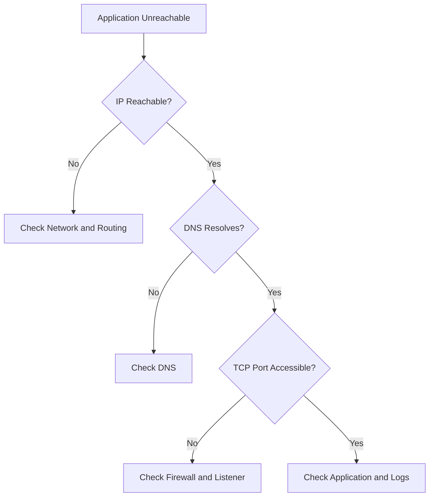
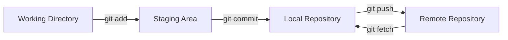
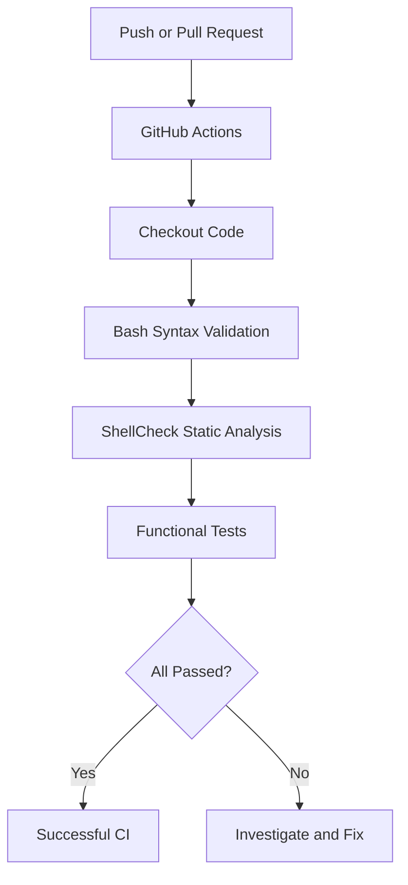

These notes summarize your completed DevOps Weeks 1–5, with the commands and concepts most useful for practical administration.

# Linux

## Week 1 — Linux fundamentals

Topics covered: Linux shell, files and directories, users, permissions, services, system logs, and Bash scripts.

|         Command        |                       Purpose                      |
|:----------------------:|:--------------------------------------------------:|
| pwd                    | Show current directory                             |
| ls -la                 | List files, including hidden files and permissions |
| cd /path               | Change directory                                   |
| mkdir -p /path         | Create directories                                 |
| cp, mv, rm             | Copy, move, delete files                           |
| cat, less, tail -f     | Read files and monitor logs                        |
| chmod +x script.sh     | Make a script executable                           |
| chown user:group file  | Change ownership                                   |
| sudo                   | Execute with elevated privileges                   |
| systemctl status nginx | Check service status                               |
| systemctl enable nginx | Enable service at boot                             |
| journalctl -u nginx    | Inspect service logs                               |
| df -h, free -h         | Check disk and memory                              |

Permissions refresher
-rwxr-xr--
 │││ │││ │││
 │││ │││ └┴┴─ Others: read
 │││ └┴┴──── Group: read and execute
 └┴┴──────── Owner: read, write, execute


Numeric permissions:
- r = 4
- w = 2
- x = 1
For example, chmod 755 script.sh grants full permissions to the owner and read/execute to group and others.

Practical scenario: Nginx is not responding. Check the service, inspect logs, confirm its listening port, and then investigate firewall or network connectivity.
## Week 2 — Linux networking
Topics covered: IP addresses, subnet masks, default gateways, DNS, TCP ports, and packet capture.

|            Command           |              Purpose              |
|:----------------------------:|:---------------------------------:|
| ip addr                      | Display IP addresses              |
| ip route                     | Display routing table             |
| ping -c 4 8.8.8.8            | Test IP reachability              |
| getent hosts example.com     | Test DNS resolution               |
| ss -tulnp                    | Display listening sockets         |
| curl -I http://localhost     | Test HTTP response headers        |
| nc -vz host 443              | Test TCP connection               |
| sudo tcpdump -i any port 443 | Capture matching traffic          |
| git restore --staged file    | Unstage file                      |
| git switch -c feature/name   | Create and switch branch          |
| git merge branch             | Merge branch                      |
| git revert COMMIT            | Reverse changes with a new commit |

Key distinction: Successful ping does not prove an application is reachable. ICMP can work while TCP port 443 is blocked or the application is stopped.


Your Ubuntu Hyper-V lab also covered testing successful connections on ports 22 and 80, and a failed connection to port 65000.

# Git

## Week 3 — Git fundamentals
Topics covered: Local repositories, commits, staging, restoring changes, branching, and merging.


|           Command          |              Purpose              |
|:--------------------------:|:---------------------------------:|
| git init                   | Initialize repository             |
| git status -sb             | Check branch and changes          |
| git add file               | Stage changes                     |
| git commit -m "message"    | Create commit                     |
| git log --oneline --graph  | View commit history               |
| git diff                   | Inspect unstaged changes          |
| git diff --staged          | Inspect staged changes            |
| git restore file           | Discard unstaged file changes     |
| git restore --staged file  | Unstage file                      |
| git switch -c feature/name | Create and switch branch          |
| git merge branch           | Merge branch                      |
| git revert COMMIT          | Reverse changes with a new commit |

Important distinction: git revert preserves history by creating a new commit. git reset moves the current branch's pointer and can discard changes depending on the option used.

## Week 4 — GitHub and Pull Requests
You created a private GitHub repository, configured origin, pushed code, created feature branches, and merged Pull Requests.

Git versus GitHub: Git manages version history. GitHub hosts Git repositories and provides collaboration features, including Pull Requests and Actions.

Your typical workflow:

~~~git switch master
git pull --ff-only

git switch -c feature/my-change

# Edit files

git add .
git commit -m "Describe change"
git push -u origin feature/my-change
~~~

Then create a Pull Request, review the changes and checks, merge it, and synchronize your local master.

Fetch versus pull
- git fetch downloads remote history and updates remote-tracking references without merging it into your current branch.
- git pull fetches and then integrates changes into the current branch.
- git pull --ff-only refuses to integrate when a fast-forward isn't possible.
You also configured GitHub rulesets. However, GitHub reported that those rulesets were not enforced for your private repository under its current plan. Therefore, manual CI verification remains important.

## Week 5 — GitHub Actions and automated testing
Topics covered: CI/CD fundamentals, workflow YAML, GitHub-hosted runners, Bash syntax validation, ShellCheck, functional tests, and troubleshooting.

Your CI pipeline:



```
name: Bash CI

on:
  push:
  pull_request:

jobs:
  validate:
    runs-on: ubuntu-latest

    steps:
      - name: Checkout repository
        uses: actions/checkout@v4

      - name: Validate Bash syntax
        run: |
          bash -n health.sh
          bash -n disk_status.sh
          bash -n tests/test_disk_status.sh

      - name: Install ShellCheck
        run: |
          sudo apt-get update
          sudo apt-get install -y shellcheck

      - name: Run ShellCheck
        run: shellcheck health.sh disk_status.sh tests/test_disk_status.sh

      - name: Run functional tests
        run: bash tests/test_disk_status.sh
```

This is a consolidated reference example, not a claim that every line exactly matches your latest repository file.

Your functional-testing thresholds

| Input | Expected output | Function exit code |
|:-----:|:---------------:|:------------------:|
| 27    | HEALTHY         | 0                  |
| 79    | HEALTHY         | 0                  |
| 80    | WARNING         | 1                  |
| 95    | WARNING         | 1                  |
| abc   | ERROR           | 2                  |
| 105   | ERROR           | 2                  |

Remember that the function's warning exit code of 1 is expected by your tests, while the complete test runner returns 0 when all assertions pass.

```mermaid

```