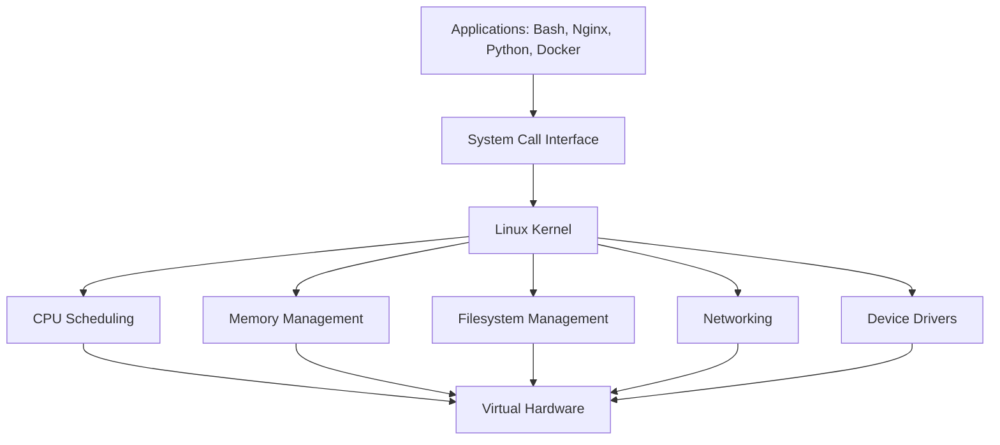
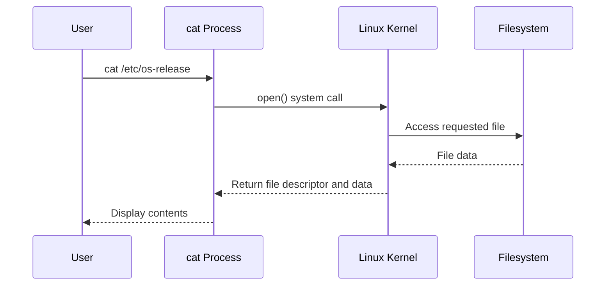
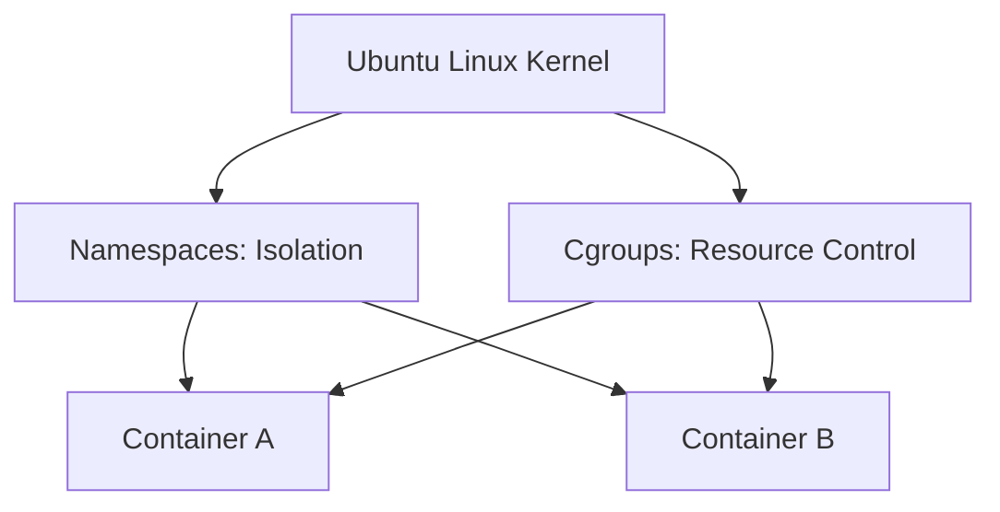
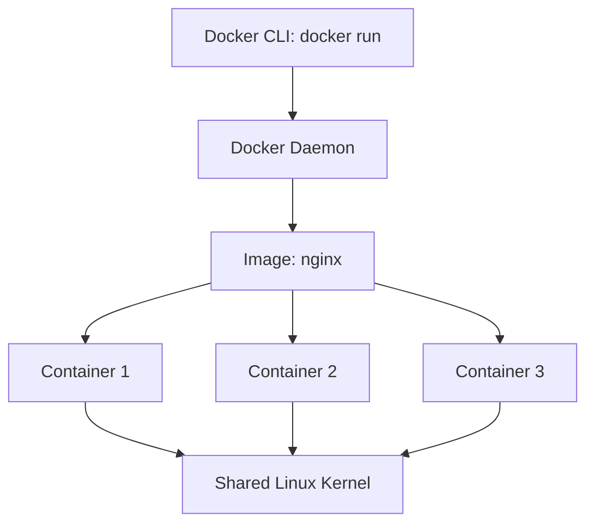
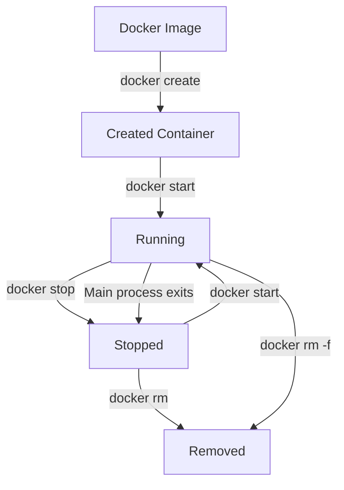
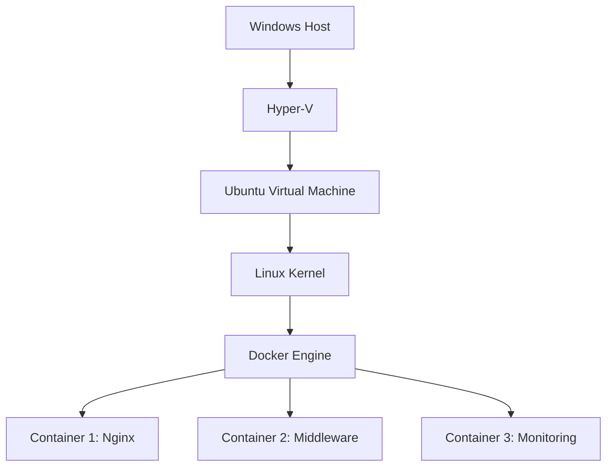

Planned lessons
1. Monday — Containers vs. virtual machines; Docker architecture
2. Tuesday — Images, containers, Docker Hub, essential commands
3. Wednesday — Build your first Docker image using a Dockerfile
4. Thursday — Ports, volumes, environment variables, and logs
5. Saturday — Containerize a small application and troubleshoot it
6. Sunday — Docker assessment and revision

# Containers versus virtual machines
Learning objective: Understand what a container is, why Docker exists, and how it differs from your Ubuntu Hyper-V VM.

A virtual machine runs its own guest operating system on virtualized hardware. A container packages an application and its dependencies while sharing the host's kernel.

Docker containers do not require a separate operating system kernel. Linux containers share the host's Linux kernel while running their applications and dependencies in isolated environments.

One important distinction: a container image can contain operating-system user-space components, such as Ubuntu libraries and utilities, but it does not contain or boot a separate Linux kernel.

# What is a kernel?
The kernel is the core component of an operating system. It manages hardware resources and provides controlled access to those resources for applications. When an application needs memory, disk access, networking, or CPU time, it generally relies on services provided by the kernel.
The applications (Nginx, docker Engine, Bash, Python) don't independently manage physical hardware. They request operating-system services through the kernel.


## What does the kernel actually do?
There are *five* major responsibilities worth understanding.

1. Process management and CPU scheduling
The kernel decides which processes get CPU time and when. If Nginx, Docker and Python all need CPU resources, the scheduler coordinates their execution.
Linux commands: ps aux, top, htop

2. Memory management
The kernel manages virtual memory, allocates physical memory to processes, and protects process address spaces.
Linux commands: free -h, vmstat, cat /proc/meminfo

3. Filesystem management
The kernel provides filesystem interfaces for reading and writing files, working with permissions, and interacting with storage devices.
Linux commands: df -h, lsblk, mount

4. Network management
The kernel implements networking functionality such as TCP/IP, routing, sockets, and packet filtering.
Linux commands: ip addr, ip route, ss -tulnp

5. Device management
The kernel uses drivers to communicate with devices such as network adapters, storage controllers, and other hardware.
Linux commands: lspci, lsmod, dmesg

Kernel space versus user space:
Linux separates execution into two major environments.

|                User space               |                    Kernel space                   |
|:---------------------------------------:|:-------------------------------------------------:|
| Where ordinary applications run         | Where the kernel operates                         |
| Applications have restricted privileges | Kernel has privileged hardware access             |
| Examples: Bash, Python, Nginx           | Examples: scheduler, memory manager, TCP/IP stack |
| Applications request kernel services    | Kernel performs privileged operations             |

This separation helps prevent ordinary applications from directly modifying protected kernel memory or controlling hardware arbitrarily.

Suppose you execute: ```cat /etc/os-release ```


In reality, reading involves additional system calls, such as read(), and possibly filesystem caches. The important concept is that the application requests access through the kernel rather than directly controlling storage hardware.

How Docker uses the Linux kernel:

This is the most important concept for your Docker training.

A Docker container is not a miniature virtual machine. On Linux, a container is fundamentally a set of isolated processes using Linux kernel features. Two particularly important features are *namespaces* and *cgroups*.

## *Namespaces — Isolation*
Namespaces allow processes to have different views of system resources.

For example:
- PID namespace: isolates process ID visibility.
- Network namespace: isolates network interfaces, routes and ports.
- Mount namespace: isolates filesystem mount views.
- UTS namespace: isolates hostname and domain name.
- User namespace: isolates user and group ID mappings.
Imagine two middleware containers:
``` Container A: OHIP PMS Middleware
Container B: Door Lock Middleware ```
Each container can have its own process tree, network configuration and filesystem view, even though both use the same Linux kernel.

## *Cgroups — Resource control*
Control groups (cgroups) organize processes and can account for or limit resource usage.
For example, you can constrain a container to use at most 256 MiB of RAM:
```sudo docker run --memory=256m nginx```

This is an illustrative command, not one to run yet. It would start a container and may pull an image.

In your VM, Docker reports cgroup version 2, which is the unified hierarchy used by modern Linux systems.
Namespaces versus cgroups

|   Feature  |           Main purpose          | Example                              |
|:----------:|:-------------------------------:|--------------------------------------|
| Namespaces | Isolation                       | Container sees its own process IDs   |
| Cgroups    | Resource accounting and control | Container has a 256 MiB memory limit |


Security note: Containers provide process isolation, but they share the kernel. A kernel vulnerability or overly privileged container can weaken isolation. Containers should not automatically be treated as having the same isolation boundary as separate virtual machines.

|        Term       |                                 Meaning                                | Your environment           |
|:-----------------:|:----------------------------------------------------------------------:|----------------------------|
| Kernel            | Core software managing system resources                                | Linux 5.15.0-203-generic   |
| Operating system  | Kernel plus system components and utilities                            | Ubuntu Linux environment   |
| Distribution      | Packaged Linux operating system with tools, packages and configuration | Ubuntu 22.04 LTS           |
| Shell             | Program interpreting commands                                          | Bash                       |
| Container runtime | Software that helps create and run containers                          | containerd/runc via Docker |

For example, Ubuntu and Debian can use the Linux kernel while providing different default packages, release policies and administration tools.

What happens when the kernel fails?
A serious kernel failure can affect the entire operating system.
A kernel panic occurs when the kernel encounters a critical condition from which it cannot safely recover.
Potential causes include kernel bugs, faulty drivers, hardware failures, or serious memory corruption.
Unlike an ordinary application crash, a kernel panic may make the entire VM unresponsive or require a reboot.
Useful diagnostics include:
```
uname -r
journalctl -k -b --no-pager
dmesg
```

```journalctl -k -b``` shows kernel messages from the current boot. Depending on permissions, ```dmesg``` may require sudo.

Kernel upgrades may require a reboot before the new kernel becomes active. Installing an updated kernel package doesn't necessarily change the output of ```uname -r``` until reboot.

# Images versus containers

Docker image: A read-only template containing application files, dependencies, configuration metadata, and instructions needed to create a container.
Docker container: A runnable instance created from an image, with its own process state and writable container layer.
Think of an image as a template and a container as an instance created from that template.
You can create multiple containers from the same image.
Docker architecture



```sudo docker run --rm hello-world```

| Component |                      Meaning                     |   |
|:---------:|:------------------------------------------------:|---|
| sudo      | Run Docker CLI with elevated privileges          |   |
| docker    | Docker CLI                                       |   |
| run       | Create and start a new container                 |   |
| --rm      | Automatically remove the container when it exits |   |
| hello-world | Image name, using the default latest tag         |   |


# Docker container lifecycle


# Essential Docker commands

|       Command       |                  Purpose                 |
|:-------------------:|:----------------------------------------:|
| docker images       | List local images                        |
| docker ps           | List running containers                  |
| docker ps -a        | List all containers                      |
| docker pull nginx   | Download an image                        |
| docker run nginx    | Create and start a container             |
| docker stop NAME    | Gracefully stop a container              |
| docker start NAME   | Start an existing container              |
| docker logs NAME    | Read container logs                      |
| docker inspect NAME | Inspect detailed configuration and state |
| docker rm NAME      | Remove a stopped container               |
| docker rmi IMAGE    | Remove an image                          |





```mermaid

```